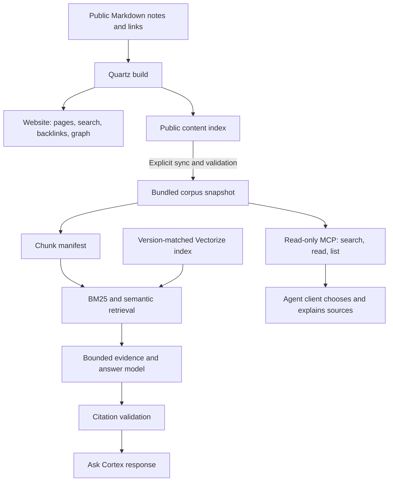

# How Cortex makes published knowledge available to people and agents

Cortex starts with a small collection of public Markdown notes. The website, chat service, and MCP tools share those sources, but each uses them differently.



## The knowledge graph

[`content/`](../content/) holds the published curriculum. Notes have stable paths and links to other notes. Quartz resolves those links into navigable pages, backlinks, and a graph view, and emits `/static/contentIndex.json` for programmatic use.

This is a document graph. It does not require a separate graph database, and the chat retriever does not traverse arbitrary paths through it. The graph helps readers navigate; titles, tags, units, and text help organize retrieval. MCP makes each note's resolved outgoing links available to an agent that wants to read related material.

## The public corpus boundary

[`sync-corpus.ts`](../workers/cortex-access/scripts/sync-corpus.ts) reads the local Quartz build at `public/static/contentIndex.json`, validates its structure and size, and writes the bundled corpus. It also accepts an explicit file path or HTTP(S) URL for a reviewed local or preview build.

The Worker imports that generated JSON at build time. Its request handlers have no path to a private authoring vault and do not fetch arbitrary URLs. Corpus validation checks slugs, filenames, metadata, and note bounds; it is not a substitute for reviewing which material is suitable to publish.

The corpus version is a hash of its content and relevant metadata. The chunk manifest records that version, stable chunk IDs, source URLs, text hashes, and estimated token counts. Short notes stay intact; longer notes are split around headings and paragraphs, with smaller pieces used when necessary.

## Ask Cortex: bounded retrieval and citations

The Quartz component appears only when `CORTEX_CHAT_ENDPOINT` is present during the site build. It calls `POST /chat` on the configured Worker.

The handler follows this sequence:

1. Validate a bounded question and conversation history. A limited amount of recent history contributes to the retrieval query.
2. Rank local chunks with BM25, a keyword-ranking method. Semantic retrieval embeds the query through Workers AI and queries Vectorize for chunks from the exact corpus version.
3. Combine the lexical and semantic rankings using reciprocal-rank fusion, then apply a confidence gate. Specific-note chunks are preferred over index-page chunks; index pages remain eligible.
4. Select at most **six chunks** within **2,500 estimated evidence tokens**. This budget covers retrieved material, not the entire model prompt or conversation history.
5. Give the answer model only those source passages as grounding evidence, each with a server-assigned source ID.
6. Validate the structured answer and map its source IDs back to public note URLs. Unknown source IDs are rejected; an answer without citations becomes the standard unsupported-answer response.

See [`hybrid.ts`](../workers/cortex-access/src/retrieval/hybrid.ts), [`vectorize.ts`](../workers/cortex-access/src/retrieval/vectorize.ts), and [`chat.ts`](../workers/cortex-access/src/chat.ts).

Missing semantic bindings or an invalid confidence threshold cause a configuration error. Retrieval failures do not trigger a full-corpus fallback. When the retrieved material does not pass the confidence gate, the service returns an unsupported-answer response before calling the answer model.

Citation validation proves that a cited source was retrieved and is allowed. It cannot prove that every sentence accurately follows from the source. The model can still misinterpret evidence, and confidence thresholds need evaluation when the corpus or embedding model changes.

## MCP: evidence for an agent client

The MCP route exposes three tools:

| Tool                | What it returns                                                      |
| ------------------- | -------------------------------------------------------------------- |
| `search_cortex`     | Up to ten ranked excerpts with public URLs                           |
| `read_cortex_note`  | One indexed note, its tags, and resolved outgoing links              |
| `list_cortex_units` | Teaching units in curriculum order, optionally including their notes |

MCP search uses its own lexical ranker: title, slug, and body matches, plus a small boost for matching linked-note titles. It does not call the chat model or use chat's hybrid retrieval pipeline. Reading a note is an exact indexed-slug lookup, not an arbitrary filesystem or URL read.

An agent can search, read a result, inspect its links, and choose another note to read. That sequence is client-directed. The server has no tool for editing notes, taking actions in other applications, or traversing the entire graph automatically. Its request and result sizes are bounded, and results identify the corpus version. See [`mcp.ts`](../workers/cortex-access/src/mcp.ts) and [`content.ts`](../workers/cortex-access/src/content.ts).

Chat and MCP share source code but can be deployed separately with independent enable switches and access policies. MCP does not need an answer-model or embedding binding.

## Keeping the corpus in sync

For a local content change, keep the Quartz development server running on port 8080. In a second terminal, from `workers/cortex-access/`:

```sh
pnpm run sync:corpus http://127.0.0.1:8080/static/contentIndex.json
pnpm run validate:corpus
pnpm run build:retrieval-manifest
pnpm run validate:retrieval-manifest
pnpm test
pnpm run check
```

These commands update local generated files and validate them; they do not publish the website or deploy a Worker. Review the generated diff before including it in a change. Test fixtures that record semantic candidates are tied to a corpus version and may also need deliberate regeneration after content changes.

A model-backed release additionally needs embeddings for the selected manifest in the intended Vectorize index, using the matching corpus version and embedding model. The checked-in indexing scripts are operator tools that make external calls; they are not part of the provider-free test path. The Worker guide covers configuration and release responsibilities.

The public site, Worker corpus, and semantic index can become out of step because they are separate artifacts. Verification must check the content version and exercise both chat and MCP after an applicable release. Merely merging source or building the website does not establish that all three agree.

## Reproducing behavior

The [root README](../README.md#check-the-code) gives the installation and test commands. The deterministic loopback test runs the real selector and citation checks against a local mock, with injected semantic candidates. It needs no model credentials and makes no provider call.

Recorded semantic fixtures are evaluation inputs, not a live index. The offline evaluator has separately configurable thresholds and selection limits; its output must not be presented as proof of a deployed configuration. A real chat deployment requires provisioned services and a separate end-to-end check.
